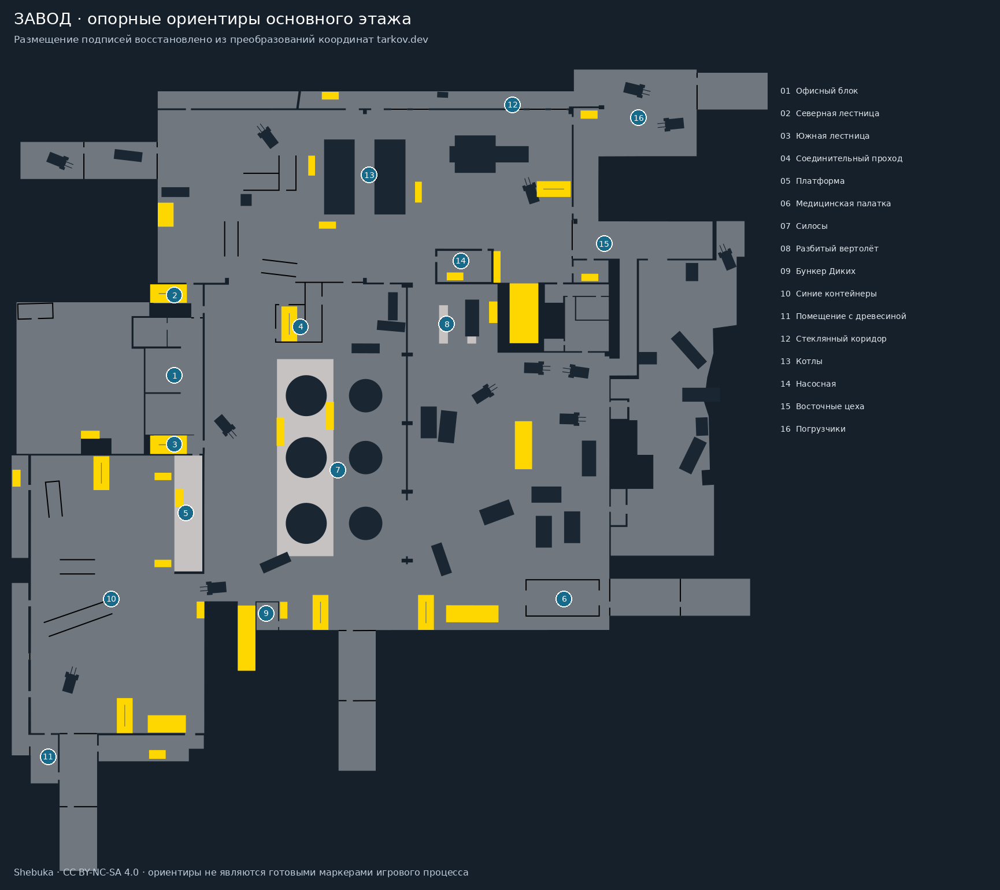
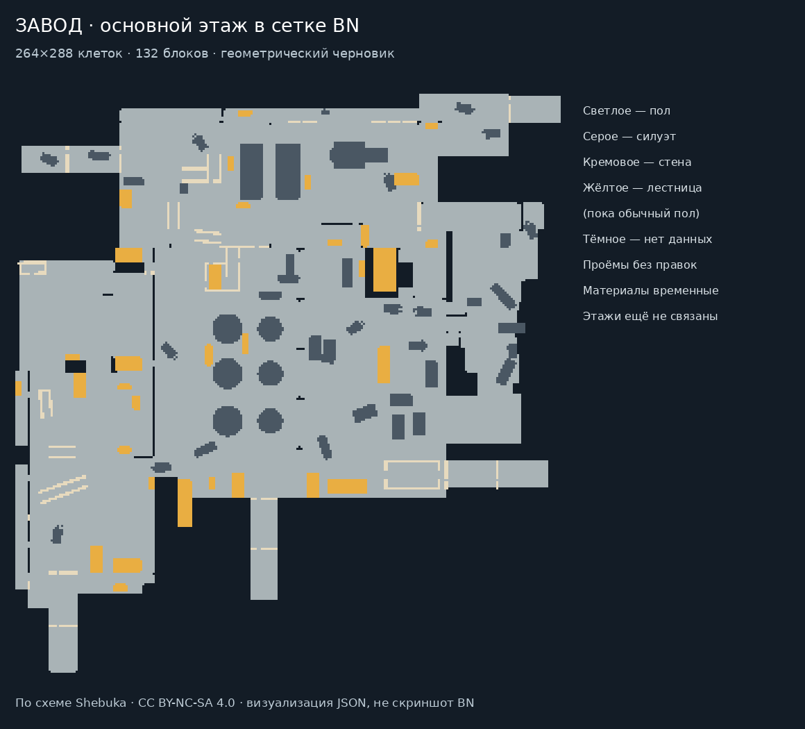
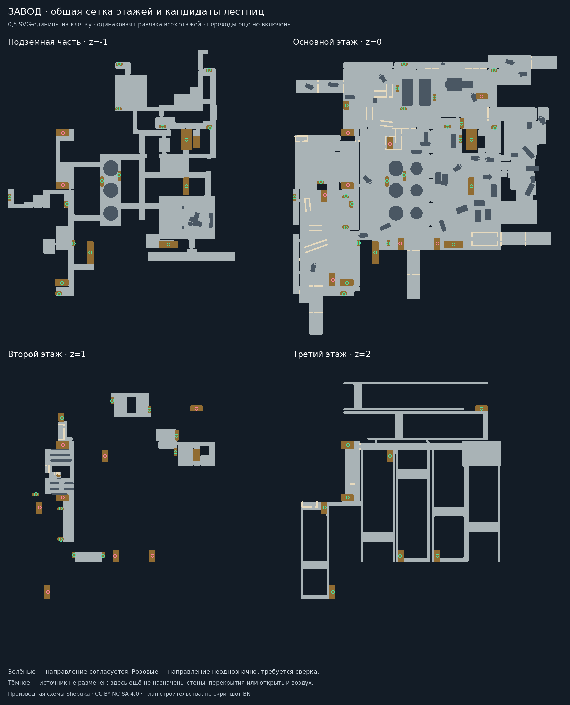
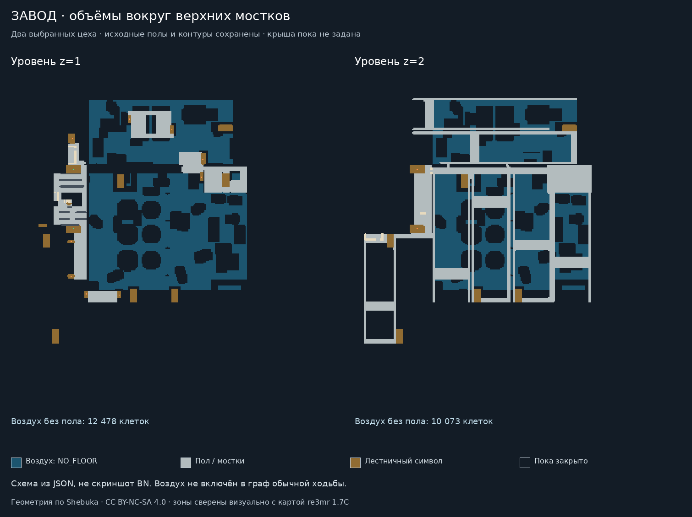

# Завод — восстановление по исходной схеме

Текущий этап: **многоэтажный макет с лестницами и первыми цеховыми объёмами**.
Создан отдельный мод `trkv_factory_dev`: 264×288 клеток, 132 блока 24×24, z=0.
Он ещё не подключён к рейду; двери, материалы, свет и вертикальные переходы требуют
следующих этапов. Технический `industrial_01` остаётся отдельным средством проверки.



## Зафиксированная основа

В `reference/Factory.svg` сохранена неизменённая схема Shebuka из
[tarkov-dev-svg-maps](https://github.com/the-hideout/tarkov-dev-svg-maps).
Точный репозиторный коммит — `5a8b6115d1c0cf56f2ebaac1a96fa5ae3074d178`,
последнее изменение самого файла — `81177ae3aa7757665548f6cb20cdbfb38929f738`
от 07.11.2024. Хеш и ограничения — в `source_lock.json`.

Это основа внутренних контуров переработанного Завода. Она **не подтверждает
соответствие всех внешних участков и поздних изменений версии игры на октябрь 2026**.
Номер игрового патча в SVG не указан. Проверку современных дополнений вести
отдельно, не подменяя неизвестные помещения выдуманной геометрией.

Четыре слоя сопоставлены с будущими z=-1/0/1/2: подземная часть, основной,
второй и третий этажи. Источник сохраняет взаимное расположение офисного блока,
силосов, цехов, верхних переходов и подземных коридоров. В `reference_floors.png`
слои показаны раздельно; это графика источника, не игровой скриншот.

Для подписей использована фактическая привязка tarkov.dev: исходные game x/z,
поворот 90°, CRS transform и bounds SVG overlay. Географический север пока не
установлен. 27 ориентиров с русскими названиями сохранены в `landmarks.json`;
16 из них относятся к основному этажу. Координаты двух офисных лестниц после
преобразования попали в соответствующие области лестниц самого SVG. Подписи
не являются точками появления, добычей или уже работающими POI.

## Что показала пробная сетка

Координаты SVG не объявлены метрами или клетками BN. Сравниваются три варианта
дискретизации; поля сетки дополняются до кратности 24 без растяжения контуров.

| SVG-единиц на клетку | Размер на уровень | Блоков 24×24 | Участков основного этажа | Доля крупнейшего участка |
|---|---|---|---|---|
| 1,0 | 144×144 | 36 | 7 | 97,63% |
| 0,75 | 192×192 | 64 | 6 | 96,43% |
| 0,5 | 264×288 | 132 | 7 | 99,71% |

Это четырёхсвязный граф грубой классификации силуэтов. Более мелкий шаг сам по
себе не гарантирует улучшения: на результат влияют фаза сетки, тонкие линии,
порог покрытия и ещё не выделенные дверные проёмы. Изолированные участки пока
не объявлены ошибками оригинала. Часть может требовать открытия двери или
вертикального подхода; часть могла отсечь дискретизация.

Вариант 0,5 — рабочий кандидат для дальнейшей сверки проходов, **не утверждённый
размер финальной карты**. Офисные помещения, мостки, лестницы и спорные участки
нужно проверить до выбора масштаба. Общий объём четырёх уровней при таком шаге
составит 528 блоков; это требует отдельной проверки загрузки/стриминга, а не
подмены размера существующего технического рейда.

## Вертикальные связи

Из SVG извлечены 80 появлений лестничных обозначений. В `vertical_reference.json`:

- 34 кандидата связи соседних уровней с согласующимися направлениями обозначений;
- ещё 10 совпадений геометрии соседних этажей с неоднозначным направлением;
- отдельно сохранены обозначения, не вошедшие в однозначные пары.

Один и тот же символ может присутствовать на нескольких этажах. По совпадению
ID нельзя автоматически создать телепорт или решить, где находится промежуточная
площадка. Офисные лестницы особенно важны: их непрерывность нельзя потерять из-за
условного именования SVG-групп `up`/`down`. Реальные парные переходы BN пока не
размещены; неизвестные связи не заменены новыми лестницами.

## Содержимое и воспроизведение

- `source_lock.json` — фиксация источника и его ограничений;
- `reference/` — оригинальная SVG, лицензия и фактические метаданные привязки;
- `landmarks.json` — ориентиры в координатах SVG и проверки регистрации;
- `vertical_reference.json` — лестничные обозначения и неоднозначные связи;
- `raster_audit.json` — параметры выборки, версии инструментов и результаты;
- `candidate_*.json` — четыре пробных сетки при шаге 1,0 для анализа;
- три PNG — раздельные уровни, сравнение с сеткой и опорные ориентиры.

```sh
python tarkov/tools/locations/inspect_factory_reference.py
python tarkov/tests/locations/reference_sampling_test.py -v
```

Нужны Inkscape CLI, NumPy, Pillow и DejaVu Sans. Инспектор проверяет хеш источника,
сохраняет геометрию в исходных координатах и не чинит проходы автоматически.
Проверка точной интеграции покрытия выявила и исключила нежелательное растяжение
при округлении сетки: неполная последняя клетка остаётся неполной. Четыре теста
сохранения площади, пустых полей и положения тонкой границы прошли локально.

## Следующая реализация

Сверить спорные проёмы и лестничные площадки с изображениями; дополнить отсутствующие
участки, которые схема не отражает, по согласованным референсам. Геометрический
черновик основного этажа уже упакован в mapgen; следующие этажи пока в референсах. Материал и игровые свойства стен/силосов/станков определяются
отдельно: силуэт на SVG не доказывает ни непрозрачность, ни пулестойкость.

Для проверки загрузки BN отдельно выполняется технический probe `industrial_01`.
Его успех не будет доказательством, что Завод уже сгенерирован или принят в игре.

## Авторство

Оригинальная схема: Shebuka / Escape from Tarkov SVG Maps Project,
CC BY-NC-SA 4.0; полный текст сохранён в `reference/LICENSE.md`.
Послойные изображения, пробные сетки и визуальные производные этой схемы
сохраняют ту же лицензию. Изменения: разделение слоёв, русские подписи,
привязка ориентиров и исследовательская дискретизация. Исходная SVG не изменена.
Эта атрибуция относится к указанным данным карты, а не к коду движка BN.

## Черновик основного этажа



`ground_geometry.json` фиксирует сетку при шаге 0,5; `ground_manifest.json` —
132 блока, локальные координаты и явные отступления. `ground_static_report.json`
подтверждает отсутствие пропущенных/перекрывающихся клеток, соответствие mapgen
этой сетке и проходимость по свойствам точной основы BN. Из 40 932 проходимых
клеток 40 813 входят в крупнейший четырёхсвязный участок; ещё шесть участков
пока требуют проверки. Добавленных проходов нет.

Неразмеченные области закрыты `t_rock` как техническая граница. Это не утверждение,
что в оригинале там скала или стена. Линии стен и силуэты временно используют
`t_concrete_wall`: свойства оборудования, прозрачность и сопротивление пулям
по SVG не определяются. Лестничные обозначения пока дают обычный пол; нижний и
верхние этажи не генерируются этим модом. Точек появления и выходов ещё нет.

Мод зависит только от `bn`, не подключает runtime-хуки. Спецразмещение
`trkv_loc_factory_01_ground_draft` имеет `occurrences: [0,0]` и доступно для
отладки, а не случайного появления в мире. Масштаб остаётся рабочим кандидатом.
Сгенерированная геометрия и её изображения — производные Shebuka, CC BY-NC-SA 4.0.

```sh
python tarkov/tools/locations/build_factory.py
python tarkov/tools/locations/check_factory.py --bn /path/to/pinned-bn
python tarkov/tests/locations/factory_validation_test.py -v
# Только в отдельном точном checkout BN, до CMake configure:
python tarkov/tools/locations/install_factory_probe.py /path/to/pinned-bn
python tarkov/tools/locations/run_native_probe.py --bn /path/to/pinned-bn \
  --exe /path/to/cata_test --output /tmp/factory-native --location factory
```

Собственный CI дополнен загрузкой этого мода и native-проверкой каждого из
76 032 terrain/furniture/проходимости клеток после настоящей генерации 132 блоков,
отсутствия случайных предметов, NPC, транспорта, полей и ловушек в трёх процессах.
До успешного завершения нового запуска это подготовленная проверка, а не результат.
Предыдущий [успешный запуск](https://github.com/ProxysRE/CataclysmAI-BN/actions/runs/40187454931)
проверил только технический `industrial_01`, не Завод.

## Проверка изменений после 2024 года

25.10.2026 проверены доступные примечания к патчам. Более поздней полной
перепланировки Завода не найдено. Основой остаётся переработка 0.15 (август 2024).
Наружные участки и комната Dragnet появились уже тогда; считать их дополнениями
2025–2026 оснований нет. Это не гарантирует полноту конкретной SVG.

- [Официальный патч 0.15](https://www.escapefromtarkov.com/news/id/307):
  переработка и наружные участки.
- [Dragnet, публикация 21.08.2024](https://www.forbes.com/sites/mikestubbs/2024/08/21/how-to-complete-the-dragnet-quest-in-escape-from-tarkov/):
  помещение квеста существовало в редакции 2024.
- [Официальный патч 0.16.9, 20.08.2025](https://www.escapefromtarkov.com/news/id/351):
  исправление патрулирования AI PMC, не подтверждение смены планировки.
- [Текущая справка Factory](https://wikiwiki.jp/eft/FACTORY): скрытый выход
  Smuggler’s Passage / записка Ark относится к 0.16.0, то есть концу 2024,
  уже после даты файла SVG. Его условия и точную привязку нужно проверить отдельно.

Проверка списка патчей не заменяет визуальную сверку дверей и полноты контуров.

## Общая сетка и план вертикальных связей

`floor_blueprints.json` переносит все четыре исходных слоя в общую сетку
264×288 при шаге 0,5. Основной этаж побайтно совпадает с `ground_geometry.json`;
масштаб и начало координат между этажами не меняются. Это строительные данные,
не четыре уже работающих уровня BN. В этих данных пустые области ещё не объявлены
открытым воздухом, перекрытием или стенами.



`vertical_plan.json` фиксирует конкретные клетки для последующей установки пар
лестниц. Выбираются только общие лестничные клетки обоих этажей внутри исходного
контура символа. Стены не прорезаются, площадки не сдвигаются к ближайшему коридору.
Для связей с согласованным направлением через один промежуточный уровень
резервируются разные клетки:
это исключает попытку одновременно записать `t_stairs_up` и `t_stairs_down` в одну.

| Группа | Число | Состояние |
|---|---:|---|
| Согласованные направления, общие клетки и примыкающий пол обоих уровней | 27 | Кандидаты для строительства и последующей проверки BN |
| Согласованные направления, но у одного конца нет примыкающего пола | 7 | Проверить пролёт и наличие промежуточной площадки |
| Соседние уровни с неоднозначным направлением | 10 | Проверить в первую очередь офисные лестницы и длинные пролёты |
| Символ с пропущенным промежуточным уровнем | 1 | `stair-134`: подвал → второй этаж; прямой переход не создаётся |

Повторение `stair-140` в группах up/down основного этажа — одно место, а не две
разные площадки. В плане оно даёт две соседние связи с разными клетками перехода.
У `stair-127` и `stair-128` совпадают офисные лестничные области всех четырёх
уровней, но пометки направления промежуточных уровней сами по себе не подтверждают
точки входа/выхода. Их непрерывность нужно сверить, а не отбросить эти этажи.

Условный граф из 34 кандидатов охватывает основной участок подвала (13 793 клетки),
основного этажа (40 813), 4 530 клеток второго уровня и 8 063 клетки третьего.
Это анализ возможности соединения, **не результат движения в BN**. В него входят
лестничные символы без горизонтального выхода; оставшийся участок верхнего уровня
из 719 клеток также требует отдельного подхода. По этим числам карта не принимается
как полностью связная. Двери, прыжки, лестницы и поиск пути проверяются отдельно.

```sh
python tarkov/tools/locations/plan_factory_vertical.py
python tarkov/tests/locations/factory_vertical_test.py -v
```

Девять проверок покрывают регистрацию этажей, границы исходных символов, отсутствие
совпадающих клеток перехода, повторение up/down, пропущенный уровень и запрет
назначать переходы на стены или неизвестные участки. Это проверки строительного
плана; они не подменяют проверку движком.

## Состояние проверки движком

[Запуск 40195986273](https://github.com/ProxysRE/CataclysmAI-BN/actions/runs/40195986273)
собрал игру и оба тестовых C++ файла. Затем общий шаг с двумя `--check-mods`
превысил лимит 5 минут. До native-генерации Завода запуск не дошёл; это не ошибка
компиляции и не подтверждённая ошибка карты.

В workflow проверки загрузки разделены: каждому моду отведено по 10 минут,
диагностика временных userdir сохраняется в артефакты. Исправление опубликовано
отдельным коммитом `0e0e03920201765dac14a0c66166353faff29345`.
[Новый запуск 40198049016](https://github.com/ProxysRE/CataclysmAI-BN/actions/runs/40198049016)
успешно завершён: игра и тесты скомпилированы, оба мода загружены,
132 блока основного этажа Завода проверены после генерации в трёх отдельных процессах.
Это результат для `trkv_factory_dev`; новый многоэтажный мод проверяется отдельно.


## Четырёхуровневый макет с лестницами

Создан отдельный `trkv_factory_stack_dev`: 528 mapgen-блоков при тех же координатах
264×288 и z=-1/0/1/2. Проверенный одноэтажный мод сохранён как независимая база
сравнения. Новый мод зависит только от `bn`, имеет свой debug-special с нулевым
числом случайных появлений, не подключён к рейду и не меняет ядро проекта.

В 27 местах добавлены парные `t_stairs_up` / `t_stairs_down_no_roof`.
На этапе топологии это были ровно 54 изменённые клетки: все были лестничными
областями источника и попадают внутрь общей области обоих этажей. Остальные
304 074 клетки тогда сохраняли исходный класс. Следующий этап воздуха описан ниже. Ни одной новой стены,
двери или прорезанного прохода в исходную сетку не внесено.

Клетка подъёма и клетка спуска имеют одинаковые x/y и соседние z. Сжатие
реального пролёта в такую пару — явная адаптация к BN. Кандидаты без примыкающего
пола, неоднозначные направления и пропущенный промежуточный этаж в переходы
не превращены. Их исходные лестничные обозначения пока остаются обычным полом.

`stack_manifest.json` описывает блоки и пары, `stack_geometry.json` — итоговые
ряды, `stack_static_report.json` — статический граф. По свойствам закреплённого
BN основной связный участок содержит 66 736 клеток: подвал 13 793, основной этаж
40 813, второй уровень 4 067, третий 8 063. Остаётся ещё 15 раздельных участков,
включая верхний участок 719 клеток. Пока карта не объявляется полностью связной.

Базовый макет проверял **топологию**: неразмеченные клетки были закрыты тестовой
границей `t_rock`. В текущем этапе часть таких клеток заменена воздухом по
ограниченным правилам, остальная тестовая граница пока сохраняется. В финальной карте это не должно превращаться в выдуманные
сплошные стены вокруг верхних мостков. Открытые объёмы, атриумы, перекрытия,
падение, крыша, реальные материалы и свет требуют отдельной реализации.

```sh
python tarkov/tools/locations/build_factory_stack.py
python tarkov/tools/locations/check_factory_stack.py --bn /path/to/pinned-bn
python tarkov/tests/locations/factory_stack_test.py -v
python tarkov/tools/locations/install_factory_stack_probe.py /path/to/pinned-bn
python tarkov/tools/locations/run_native_probe.py --bn /path/to/pinned-bn \
  --exe /path/to/cata_test --output /tmp/factory-stack --location factory-stack
```

Новый native-probe генерирует все 528 блоков на четырёх z, сверяет terrain,
furniture, traps, содержимое и флаги GOES_UP/GOES_DOWN каждой клетки. Затем строит
граф по фактической проходимости и флагам сгенерированных клеток и сравнивает
размер главного участка со статическим результатом. Переход допустим только
между парой соответствующих лестниц. Проверка подготовлена для трёх процессов
с разными seed; для варианта с воздухом эта проверка успешно прошла в запуске 40210248304.

Этот граф не является проверкой `game::vertical_move`, действия игрока или
поиска пути НПС. Windows-интерфейс, полноценный рейд и сохранение многоэтажного
макета также ещё не проверены. Геометрические производные сохраняют атрибуцию
Shebuka и лицензию CC BY-NC-SA 4.0.


## Первые открытые цеховые объёмы



В `volume_rules.json` выделены два внутренних цеховых участка в координатах SVG.
Выбор сверялся визуально с панелями этажей [карты автора re3mr, редакция 1.7C](https://reemr.se/factory/).
Её оригинальный PNG получен с сайта автора, зафиксированы SHA-256, размеры, URL,
дата и лицензия в `reference/re3mr_source.json`. Рядом сохранена уменьшенная полная
копия с авторством и легендой. Это дополнительный визуальный референс;
автоматической метрической регистрации с SVG нет.

В этих зонах 22 551 неразмеченная верхняя клетка заменена на `t_open_air`:
12 478 на z=1 и 10 073 на z=2. Открываются только клетки над явно размеченным
полом основного этажа, когда на самом верхнем слое нет нарисованного пола,
препятствия, стены или лестницы. Вокруг оборудования, стен основного этажа и
лестничных обозначений оставлен запас две клетки. Офисный блок, подвал, основной
этаж, внешний периметр и остальные участки таким правилом не открываются.

Это ограниченная интерпретация согласованных планов этажей, а не измеренные
высоты помещений. Реальная высота оборудования, силосов и крыши пока не
установлена. Запас вокруг препятствий сохраняет лишние технические заглушки;
они должны уточняться по референсам, а не объявляться окончательными колоннами.

Полы, мостки и 27 пар лестниц не изменены. Граф обычной ходьбы сохранил прежние
66 736 клеток главного участка. Здесь учитывается `NO_FLOOR`: у `t_open_air`
положительный move_cost, но такая клетка не считается опорой и не соединяет
пешеходные участки. По одному move_cost карта ошибочно разрешала бы ходить
между мостками через воздух.

Native-probe дополнен проверкой NO_FLOOR и TRANSPARENT у воздуха, встроенного
`tr_ledge`, положительной проходимости самой terrain и исключением этих клеток
из графа стояния. Это подготовленные проверки нового варианта; поведение
падения, стрельба между этажами, `game::vertical_move`, освещение и Windows
пока этим не подтверждаются.

```sh
python tarkov/tools/locations/build_factory_stack.py
python tarkov/tools/locations/check_factory_stack.py --bn /path/to/pinned-bn
python tarkov/tests/locations/factory_volumes_test.py -v
python tarkov/tools/locations/preview_factory_volumes.py
```

Восемь новых проверок покрывают границы зон, несовпадающие сетки, защиту исходной
геометрии и оборудования, ограничение верхними уровнями и запрет пешеходного
маршрута через воздух. Всего локально проходят 48 проверок конструктора.

[Запуск многоэтажной основы 40206518094](https://github.com/ProxysRE/CataclysmAI-BN/actions/runs/40206518094)
на момент подготовки объёмов успешно завершил компиляцию и загрузку всех трёх
изолированных модов. Генерация четырёх уровней успешно завершилась в трёх процессах. Он проверяет
коммит `4ab2eaa41c9a9130f685baa36f9bfa9f3ceee834`, то есть основу до добавления
воздуха. Вариант с воздухом затем успешно прошёл отдельный
[запуск 40210248304](https://github.com/ProxysRE/CataclysmAI-BN/actions/runs/40210248304)
на коммите `f7bfd300584e4f5b027b09365b0b1cad38ef18fb`.


## Проверка подъёма и спуска персонажа

После успешной генерации четырёх уровней подготовлен следующий native-сценарий.
Он использует те же 528 сгенерированных блоков, затем для каждой пары входит через публичный `travel_to_dimension` в собственное
тестовое измерение с областью загрузки, центрированной около этой лестницы. Тип
`trkv_factory_probe` объявлен только в экспериментальном моде; его префикс
`trkv_factory_probe_` совпадает с именем измерения. Пространство не ограничено
и не подменяет production-рейд или его политику границ.

Тест для каждой из 27 пар выполняет:

1. Выбирает нижнюю исходную площадку и проверяет фактический terrain.
2. Проверяет, что поиск лестниц BN выбирает верхнюю клетку с теми же x/y.
3. Вызывает `game::vertical_move(1, false)` и проверяет точное абсолютное положение,
   расход ходов, сохранение измерения и terrain верхней площадки.
4. Вызывает `game::vertical_move(-1, false)` и проверяет возврат на исходную клетку
   с расходом ходов. Всего 54 обычных вертикальных действия.
5. Возвращается в прежнее измерение и удаляет свои тестовые данные.

Принудительный `force=true`, телепортация вместо подъёма/спуска и дорисовывание
проходов не используются. Установка стартовой позиции лишь выбирает очередную
пару. Генерация постороннего окружения reality bubble выключается после создания
Завода; сами клетки лестниц и окружающая геометрия берутся из уже сгенерированных
submap. При неудачном выходе cleanup не выгружает ещё привязанную к карте память.

Новое имя testcase — `factory stack generates levels and avatar climbs paired stairs`.
Старый JUnit о генерации уже не может пройти как результат проверки персонажа.
Runner теперь сверяет полный список и хеши всех JSON мода, включая новый
`world_types.json`: отсутствие файла или лишний JSON отклоняются до запуска игры.

Локальные проверки протокола и геометрии проходят; **сам подъём и спуск пока не
подтверждены** — требуется новый native-запуск. Успешный запуск 40210248304
подтверждает генерацию, воздух и граф, но выполнялся до добавления действий
персонажа. Падение, баллистика между этажами, навигация НПС, cold reload и
Windows-интерфейс остаются отдельными проверками.


## Результат первого запуска с персонажем и исправление сценария

[40224035747](https://github.com/ProxysRE/CataclysmAI-BN/actions/runs/40224035747):
компиляция и загрузка модов успешны, но native-этап завершился с кодом 1 из-за
ошибок движка в журнале. В JUnit первого seed нет упавших assertions, включая
проверки подъёма/спуска; это всё равно **не принятый результат**.
Диагностика и границы вывода — в `BN_STREAMING_HANDOFF.md`.

В журнале `unload_omt` отказывается освобождать субкарты, на которые ещё
ссылается reality bubble. Тест быстро выбирал удалённые лестницы через setpos.
Новый сценарий возвращается из тестового измерения после каждой пары и входит
обратно с областью загрузки вокруг следующей. Подъём и спуск остаются обычными
`vertical_move(...,false)`; дополнительно проверяется неизменность горизонтального
origin bubble во время этих действий. Никакие debug errors не подавляются.
На seed отведено 900 секунд, поскольку исходный процесс с загрузкой данных уже
занимал около 557 секунд, а новый сценарий добавляет переходы измерений.

Полноценное движение через большой Завод и стриминг пока остаются открытой
проблемой. Исправление в ядро BN здесь не вносится. Успех узкого теста лестниц
не должен выдаваться за отсутствие ошибки стриминга.

## Исследование данных клиента

План и первоначальный read-only сканер: `CLIENT_DATA_PLAN.md` и
`tarkov/tools/client_data/inspect_tarkov_client.py`. Реальная установка Таркова
пока не исследована; сначала нужен отчёт о контейнерах из установленного клиента.
