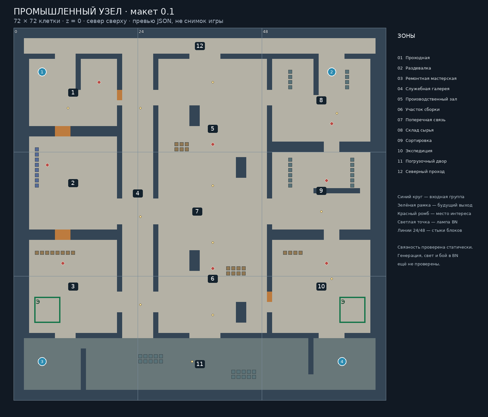

# Промышленный узел — макет 0.1.0

**Уточнение пользователя от 25.10.2026:** игровые локации должны быть максимально
приближены к оригинальным картам Escape from Tarkov. Этот собственный промышленный
макет сохраняется только как технический стенд форматов и проверок. Он не является
Заводом и не служит основой его геометрии. Направление переноса — в
`../factory_01/REFERENCE_PLAN.md`.

Первый результат по ТЗ конструктора от 25.10.2026. Собственная промышленная
планировка в атмосфере рейда, без копирования Завода. Это ранний серый макет,
**ещё не проверенная в BN карта и не интегрированный рейд**.

Основа проектной ветки при старте: `4add4eaaa9c4cbfd6b67deb77ebab95b8b404bc5`.
Ветка конструктора: `project/tarkov-locations-dev01`. BN строго
`554950f3635f50ddd1d32c6e1b6e2bdee9842bd6`.

## Планировка

72×72, z=0, девять отдельных mapgen 24×24. Пространство включает проходную,
раздевалку, мастерскую, служебную галерею, производственный зал, участок сборки,
склад сырья, сортировку, экспедицию и погрузочный двор.

Два основных продольных маршрута идут по служебной галерее шириной шесть клеток
и через производственный зал. Северный проход, двор и центральная поперечная
связь образуют петли. Между центральным и боковыми корпусами есть несколько
проходов; у двух дверных групп рядом остаются открытые пути. Прочие обычные
двери соединяют западные комнаты. Основные маршруты не требуют их открывания.

Четыре входные области: по три основных точки и одна запасная. Два будущих
выхода размещены в разных служебных частях, восемь POI — преимущественно внутри
корпуса. Все эти маркеры пока только данные manifest. Совместное появление
любых входных групп запрещено контрактом до проверки видимости в движке.



Числа обозначают зоны, синие круги — первые точки входных групп, зелёные рамки —
будущие выходы. Превью построено непосредственно из итоговых JSON.
Увеличения: `crossing_detail.png`, `sorting_detail.png`.

## Ассеты и ограничения

Использованы только BN: бетонный пол `t_thconc_floor`, двор `t_pavement`,
бетонные стены `t_concrete_wall`, обычные двери `t_door_c`, стеллажи `f_rack`,
шкафчики `f_locker`, рабочие поверхности `f_counter`, лампы `f_olight_nogrid`.
Фактические исходные свойства и пути файлов записаны в `static_report.json`.

Стеллаж непроходим, но прозрачен. Шкафчик закрывает обзор, но его стойкость
не приравнивается к бетону. Рабочая поверхность проходима с повышенной стоимостью.
Бетонные пилоны закрывают обзор и движение; их защита от конкретных патронов
не проверялась. Неразрушаемость не реализуется этим модом.

Лампа `f_olight_nogrid` в базе имеет `LOCAL_LIGHT`, `L_ON`, `light_emitted=120`
и не требует сети. Расстановка задаёт целевые светлые и более тёмные участки;
фактическая картина света, влияние крыши и дневного освещения ещё не проверены.
Служебные помещения пока минимально обставлены. Пилоны — бетонные конструкции,
а не обещание полноценных станков. Финальная детализация следует после генерации.

## Воспроизводимые статические проверки

Из корня проекта, с отдельным checkout закреплённого BN:

```sh
python tarkov/tools/locations/build_industrial.py
python tarkov/tools/locations/check_industrial.py --bn /path/to/pinned-bn --output tarkov/locations/industrial_01/static_report.json
python tarkov/tests/locations/industrial_validation_test.py --bn /path/to/pinned-bn -v
python tarkov/tools/locations/preview_industrial.py
```

Для превью нужен Pillow и DejaVu Sans в стандартном Linux-каталоге. Генератор
и проверки используют стандартную библиотеку Python. Превью не требуется для
загрузки мода. Генератор перезаписывает только свои mapgen/overmap/modinfo/manifest;
редактировать геометрию следует в генераторе. Существующие проверки core не менялись.

## Загрузка данных настоящим BN

Нужен executable, собранный из закреплённого BN. Его происхождение проверяет
сборочный процесс; один SHA исходного каталога не удостоверяет сторонний executable.

```sh
python tarkov/tools/locations/check_bn_data.py --bn /path/to/pinned-bn --exe /path/to/pinned-bn/cataclysm-bn --log /path/to/location-modcheck.log
```

Runner временно устанавливает только новый мод в чистый checkout BN, отказывается
перезаписывать существующий каталог, использует временный userdir и удаляет
установленный им мод после проверки. При ошибке BN возвращает ошибку, а не успех.
**Этот шаг пока не выполнен**. Даже его успех не доказывает настоящую генерацию.

## Безопасная ручная генерация в отдельном мире

Следующий сценарий основан на редакторе overmap закреплённого BN и ещё не пройден.
Работать только с отдельной копией сборки и новым одноразовым миром.

1. Скопировать `tarkov/mods/trkv_locations_dev` в `data/mods/trkv_locations_dev`
   отдельной сборки. Выбрать только BN и «Тарков: экспериментальные локации».
   `trkv_raid_core` для этой проверки не включать: он управляет стартом персонажа.
2. В новом мире отключить монстров, статических/случайных и стартовых NPC через
   настройки мира/сценария. Мод не добавляет спавн, но обычный мир BN сам по себе
   не изолирует внешние источники. Не использовать существующее сохранение.
3. Через debug-редактор overmap выбрать действие `PLACE_SPECIAL` / «разместить
   специальную локацию» и `trkv_loc_industrial_01`. Выбрать далёкий **ещё не
   сгенерированный** участок суши 3×3 overmap-клетки на z=0, ориентация север.
   Конкретная клавиша определяется привязками редактора; ID действия подтверждён
   в `src/overmap/overmap_ui.cpp` закреплённого BN.
4. Debug-телепортом перейти в соответствующий участок. Стартовое положение
   при необходимости поставить на локальную (24,65,0). Это тестовая телепортация,
   а не новый игровой вход. Обойти все девять блоков для их фактической генерации.
5. Проверить стыки x=24/48 и y=24/48, все двери и проходы, свет днём/ночью,
   достижимость выходных областей, отсутствие незапланированного содержимого.
   Нельзя выводить работу освещения только из размещения символа лампы.

`occurrences=[0,0]` исключает обычное случайное размещение special; ручной
редактор перечисляет specials независимо от этой частоты. У каждого overmap
terrain `NO_ROTATE`, `mondensity=0`; стандартное `extras` остаётся `none`.
Mapgen содержит только явные terrain/furniture, без предметов, NPC, монстров,
транспорта, полей, вложенных генераторов и лут-таблиц.

## Следующий этап

Получить modcheck и настоящую генерацию на BN, затем проверить движение,
двери, освещение и видимость стартов. После этого детализировать проверенную
планировку. Запрос к основному чату и уровни доказательности — `HANDOFF.md`.

Для автоматической проверки генерации подготовлен независимый test-only probe:
установка, сборка, запуск и ограничения описаны в `NATIVE_PROBE.md`.
Он пока не скомпилирован и не выполнялся в BN.
